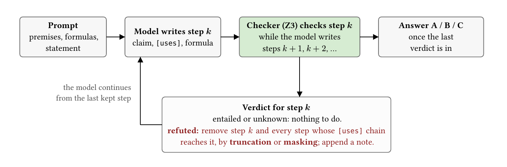
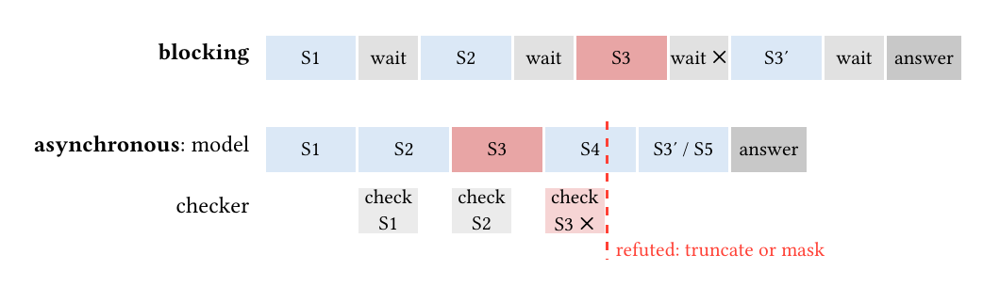
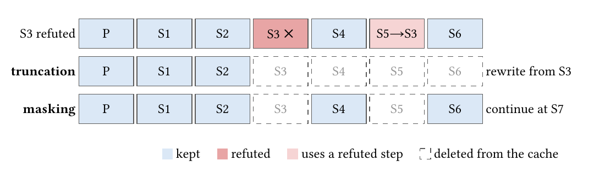
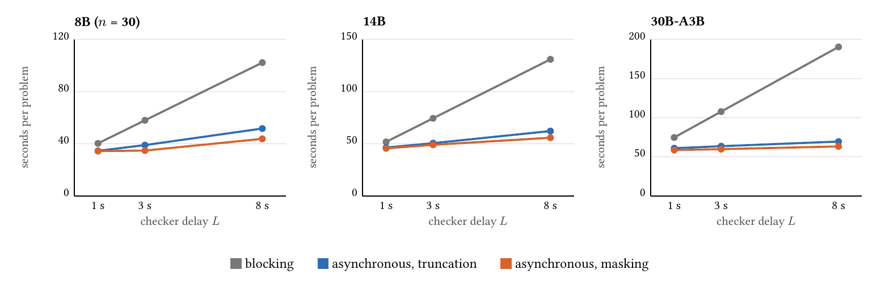
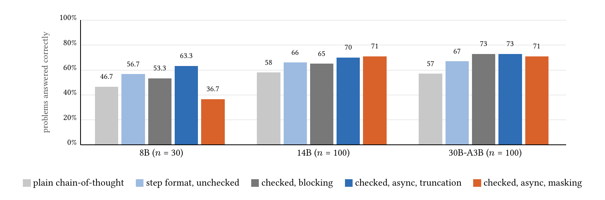
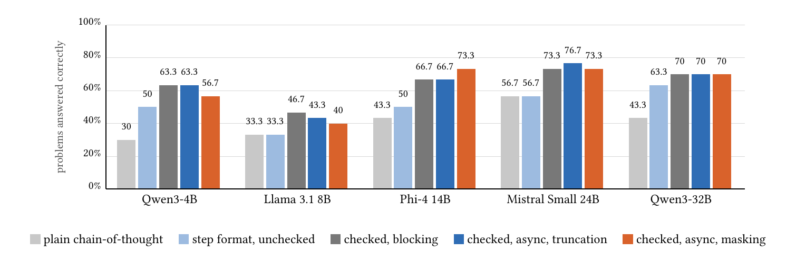

<div align="center">

# Solver-checked reasoning with KV-cache invalidation

**A small language model reasons in numbered steps. Z3 checks each step beside generation. A refuted step is deleted from the KV cache together with everything built on it.**


[**Paper (PDF)**](results/paper.pdf) · [Full report with null results](results/paper_full.pdf) · [Per-round tables](results/RESULTS.md) · [Plain-language companion](results/paper_explainer.md)



</div>

## What it does

A small model (Qwen3 4B to 32B, Llama 3.1 8B, Phi-4, Mistral Small 24B) solves first-order-logic problems from ProverQA-Hard in numbered steps. Each step carries a logic formula and a `[uses]` list of the premises and earlier steps it is derived from. Z3 checks every formula against the problem's premises. A refuted step is removed from the KV cache together with every later step that declared a dependency on it, in one of two ways:

- **Truncation** rewrites everything after the step.
- **Masking** deletes only the invalidated steps and keeps the rest.

Checker latency is simulated on a token clock so the policies can be compared at 1, 3 and 8 seconds per check.

### Blocking versus asynchronous checking

Blocking pays the checker's delay after every step. Asynchronous checking pays only when a step is refuted, and then only to rewrite the steps that have to go.

<div align="center"></div>

### Truncation versus masking

S5 declared `[uses S3]`, so it goes with S3. S4 and S6 are independent and survive masking.

<div align="center"></div>

## Findings

All comparisons are paired on the same problems (exact two-sided sign test; McNemar's test for accuracy).

- **Asynchronous checking beats blocking** on every model at every latency: faster on 27–29 of 30 problems (8B) and 77–99 of 100 (14B, 30B), p < 0.001, saving 12–67% of modeled time at the same accuracy.
- **Masking beats truncation on the Qwen3-30B at every latency and on the 14B at 8 s** (p ≤ 0.04), by 4–10%. On the Qwen3-8B with an 8-second checker masking instead loses accuracy: 36.7% vs 63.3%, 0 wins / 8 losses, p = 0.008. None of the other seven models (4B to 32B, four families) repeats that loss.
- **Loop cropping** (deleting a step whose formula repeats an earlier step's) removes 19% of generated tokens and 16% of time on the 14B (p ≤ 0.01) with identical answers.
- **The checked pipeline beats plain chain-of-thought on every model, but which half does the work depends on the family.** On the Qwen3 models the step format alone carries the gain (8–20 points; pooled 55/34, p = 0.03 on the first three, 19/7, p = 0.03 on the 4B and 32B) and the checker adds nothing. On Llama 3.1, Phi-4 and Mistral the format alone does nothing (18/16) and the checker carries it (17/3, p = 0.003; n = 30 per model, so suggestive).

The same mechanism applies wherever a verifier is slower than generation and can run beside it (an autoformalizer plus SMT solver, a proof assistant, unit tests on generated code, a tool call, a critic model). Only the Z3 case was measured here.

### Modeled time against checker delay

Every asynchronous point is below the blocking point above it at p < 0.001.

<div align="center"></div>

### Accuracy

The checked conditions use the 8-second checker. Two differences are significant: the step format over plain chain-of-thought (pooled across the three models, 55 wins / 34 losses, p = 0.03), and masking against truncation on the 8B (0 wins / 8 losses, p = 0.008).

<div align="center"></div>

On the five later models (30 problems each) the first finding splits by family: the format alone carries the gain on the two Qwen3 sizes, and the checker carries it on Llama 3.1, Phi-4 and Mistral.

<div align="center"></div>

## Layout

| Path | Contents |
|---|---|
| `run.py` | The harness: prompting, step parsing, Z3 checking, async scheduling, truncate / mask / refresh policies, loop cropping. Settings are environment variables documented at the top of the file. |
| `logic.py` | FOL parser and Z3 encoding; `Problem.supports` tests for hidden logical dependents. |
| `analyze.py`, `analyze_eff5.py`, `analyze_r6.py`, `scripts/` | Analysis: per-round tables, the round-5 efficiency comparison, the round-6 five-model sweep, diagnostics (per-class accuracy, hidden dependents), the v3 no-cap summary, the Z3 gold-label check. |
| `cloud/` | Colab driver (`colab.sh` on the Mac, `vm.sh` on the VM, `watch_cloud.py` watcher). |
| `data/hard.json` | ProverQA-Hard dev split (500 problems) from [opendatalab/ProverQA](https://huggingface.co/datasets/opendatalab/ProverQA). |
| `papers/` | The ProverQA prompt used by the `base` condition, and reading notes on related papers. |
| `related_work.md` | Novelty check against prior work. |
| `results/` | 8B runs (`v2/` is the comparable set), the write-ups, logs. |
| `results_cloud/` | 14B and 30B runs (n = 100), 8B diagnostics, 14B efficiency run, the five-model sweep (n = 30), VM logs. |
| `docs/figures/` | Figures from the paper, used in this README. |

Each run writes one JSON line per problem with the answer, token counts, waits, every step with its formula and verdict, and what happened to it.

## Running

```bash
uv venv .venv --python 3.12
uv pip install --python .venv/bin/python llama-cpp-python==0.3.36 z3-solver numpy huggingface-hub
# a Q4_K_M GGUF from Qwen's Hugging Face repos, e.g. Qwen/Qwen3-14B-GGUF -> models/Qwen3-14B-Q4_K_M.gguf
# other families: the chat template is picked from the file name (run.py TEMPLATES); cloud/vm.sh src() lists the GGUF sources
MODEL=models/Qwen3-14B-Q4_K_M.gguf OUT=results_cloud/Qwen3-14B/lat8 LATENCY=8 GUARD=1 MASK_ON=refuted \
  .venv/bin/python run.py --n 100 --cond lag_mask      # conditions: base fmt sync lag_trunc lag_mask lag_refresh
LOOP=2 DEPWAIT=1 ... .venv/bin/python run.py --n 30 --cond lag_trunc   # loop cropping, dependency-scoped waiting
.venv/bin/python run.py --spike                         # KV-removal smoke test for the backend
.venv/bin/python analyze.py                             # tables for RESULTS.md
.venv/bin/python analyze_eff5.py                        # round 5 paired comparison
```

`cloud/colab.sh up | setup MODEL | start MODEL n [v3|mini|eff] | beat | pull | down | usage` runs the same thing on a Colab GPU through Google's Colab CLI. `start "M1,M2,..." 30 sweep` runs several models in turn. The 14B and 30B results took about 18 L4 GPU-hours; the five-model sweep 3.3 A100 GPU-hours.

## Contact

Aditya Bankoti, University of Washington. Questions and corrections: open an issue on this repository.
